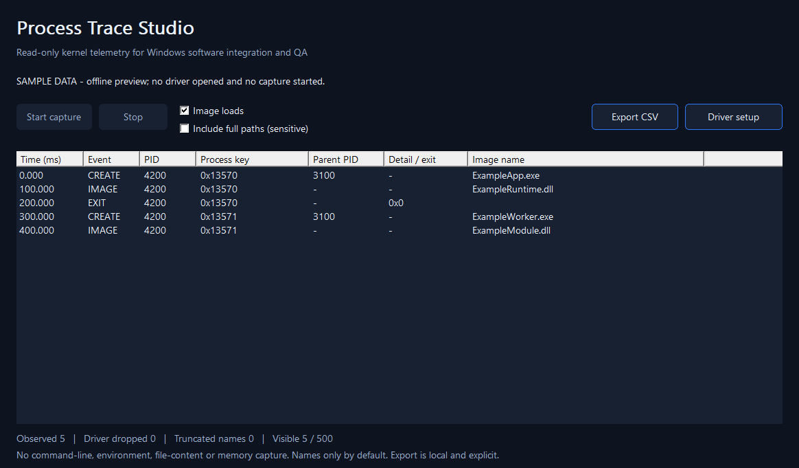

# Process Trace Studio

**Windows kernel process and image telemetry, with a small native C++ SDK.**

Capture process creation, process exit and optional EXE/DLL/driver-image load notifications for software integration, troubleshooting and QA. Correlate events using a Windows process-start key rather than PID alone. View them in a native desktop interface, stream CSV from the console or embed the two-file SDK in your application.

> **Microsoft-signed evaluation:** release 0.1.1 includes self-contained installers with the returned signed 0.1.0.0 driver. Its console installer and real process/image capture passed a Windows 10 x64 VM campaign. Windows 11, HVCI and broader qualification remain pending. Microsoft signing is not WHQL certification or a guarantee of universal compatibility.



## What it records

| Event | Available information |
|---|---|
| Process created | PID, Windows process-start key, process creation time, parent PID and an observed parent key, image basename |
| Process exited | PID, the same process-start key and creation time, exit NTSTATUS |
| Image loaded | EXE/DLL or kernel image basename, owning process identity when available, kernel/unknown-identity flags |
| Capture status | Session number, QPC frequency/start time, observed events, ring overwrites, truncated names and queued count |

Command lines, environment variables, file contents, packets and process memory are never collected. Full paths are **off by default** and can be enabled explicitly. Capture never starts automatically. No telemetry is uploaded and no cloud account is required.

The driver is a passive observer. It does not block processes, bypass access controls, protect another program, inspect arbitrary memory or execute caller-provided kernel code. It is not an antivirus or EDR product.

## Try the interface now

Download the complete evaluation package from [Releases](https://github.com/titanfyre/Process-Trace-Studio/releases), extract the ZIP and run:

```powershell
.\ProcessTraceStudio.exe --preview
.\ProcessTraceCLI.exe --preview
```

These commands use synthetic data only; they do not open a driver. The repeated example PID illustrates that two different processes can reuse a PID while retaining different process-start keys.

## Capture with a validated signed package

Download the complete signed evaluation ZIP from Releases:

1. Extract the complete release ZIP. Run `ProcessTraceSetup.exe` as administrator and select **Install / reinstall**.
2. Restart Windows only if setup requests it. Installation leaves capture inactive.
3. Run `ProcessTraceStudio.exe` as administrator. Leave full paths disabled unless needed, then select **Start capture**.
4. Perform your software test. **Stop** or close the client to stop collection and release ownership.
5. **Export CSV** saves the latest 500 visible events to a new local file. Existing files are preserved. Use the CLI or SDK for a longer stream.

The console installer supports `/install` and `/uninstall`. It reports Windows error codes, never restarts automatically, and returns `3010` when a restart is required. Installers embed only their own package, reject a catalog without a trusted Microsoft Hardware Compatibility Publisher signature, and never enable test signing.

Only one administrator client owns the telemetry device at a time. Access denied means elevation is required; a sharing violation means another client is open. The SDK reports detailed English Windows errors.

```powershell
# Ten seconds of live events; requires the validated signed driver and elevation.
.\ProcessTraceCLI.exe --seconds 10 > events.csv
# Optional: omit image-load events or explicitly include full paths.
.\ProcessTraceCLI.exe --seconds 30 --no-images
.\ProcessTraceCLI.exe --seconds 30 --full-paths
```

## Embed the SDK

Add `SDK/ProcessTrace.h` and `SDK/ProcessTrace.cpp` to a Windows x64 C++17 application and link `setupapi.lib`. An owned `Client` releases the device when destroyed; file cleanup also stops capture if the process terminates.

```cpp
#include "ProcessTrace.h"
#include <iostream>

int main() {
    try {
        ProcessTrace::Client trace;
        trace.Start();                         // images on; full paths off
        auto batch = trace.Receive(1000);       // wait up to one second
        for (unsigned long i = 0; i < batch.count; ++i)
            std::wcout << batch.events[i].pid << L" "
                       << ProcessTrace::Name(batch.events[i]) << L"\n";
        trace.Stop();
    } catch (const std::exception& error) {
        std::cerr << error.what() << '\n';       // detailed English error
        return 1;
    }
}
```

`Start(images, fullPaths)`, `Receive(timeout, stopEvent)`, `Status()`, `Stop()` and `Cancel()` are the capture API. `Name()`, `Csv()` and `Valid()` decode and validate returned data. Use one receiving thread per client. Before destroying a client, signal its stop event, call `Cancel()` and join its receiving thread. See [Examples/capture.cpp](Examples/capture.cpp) and [protocol details](docs/PROTOCOL.md).

## Precision and limits

Events are timestamped using the kernel performance counter at the notification callback. This measures **when this driver observed a notification**, not application execution time, disk I/O duration, CPU scheduling latency or every instruction in a process. Events already completed before capture starts are not inventoried. Image callbacks do not provide unload events or file hashes.

The preallocated driver ring holds 512 events and returns up to 16 per batch. A slow consumer overwrites the oldest entries and increments a visible drop counter. Image-load activity can be high; turn it off when unnecessary. The desktop keeps 500 visible rows and bounds its handoff queue. It reports separate UI queue skips. This is an event viewer, not a durable audit log.

Process-start keys are Windows identities within a boot, not persistent device identifiers. A capture session is local to this loaded driver. A parent lookup observes whichever process currently owns the parent PID at callback time; the observed-parent flag does **not** prove the original logical parent's identity. Names can be truncated and are not necessarily canonical paths.

## Build and validation

Windows 10 2004+ / Windows 11 x64 is the intended initial target. Windows Server, ARM64 and WHQL/HLK certification are not claimed.

```powershell
# Visual Studio 2022: Desktop development with C++, CMake.
.\Build.ps1
# Current MSVC tools with the AddressSanitizer component.
.\Build.ps1 -AddressSanitizer
```

Outputs are under `obj/Build/bin/Release` or `obj/Asan/bin/Release`. The build includes GUI, CLI, offline tests and installer sources. An installer built without `-DriverPackageDirectory` has no embedded driver and cannot install one. Only a separately validated Microsoft-signed package should be supplied through that parameter.

See [validation results and remaining runtime checks](docs/VALIDATION.md). The public repository contains application, installer and SDK source; the original kernel source remains private.

## OEM integration and support

For supported redistribution, custom integration or deployment assistance, contact **`titancsa` on Discord**. The public application and SDK are MIT licensed. Any separately supplied kernel binary has its own evaluation/commercial terms; the MIT license does not license that private binary. No secure trial timer or online activation is implemented in this preview.

Microsoft signing establishes trust in a submitted binary; it does not establish that the product is Windows Certified or universally compatible. [Microsoft signing guidance](https://learn.microsoft.com/windows-hardware/drivers/dashboard/driver-signing-offerings). Existing tools such as [Sysmon](https://learn.microsoft.com/sysinternals/downloads/sysmon) cover many similar telemetry needs; this project's focus is an embeddable, bounded C++ data stream.

This project is intended for lawful development, diagnostics and administration on authorized systems. You are responsible for your use, deployment and compliance with applicable requirements. Software is provided under the license's warranty and liability terms; it does not authorize illegal activity.

## Signed evaluation download

Release 0.1.1 bundles the returned Microsoft-signed 0.1.0.0 driver in the
self-contained UI and console installers. Catalog trust, INF/SYS membership and
preserved executable content were checked. The console installer and real driver
passed a Windows 10 build 19045 x64 VM campaign; previous normal/targeted Verifier
checks covered the same submitted code. Windows 11, HVCI, extended coexistence and
production qualification remain pending. Microsoft signing is not certification.
